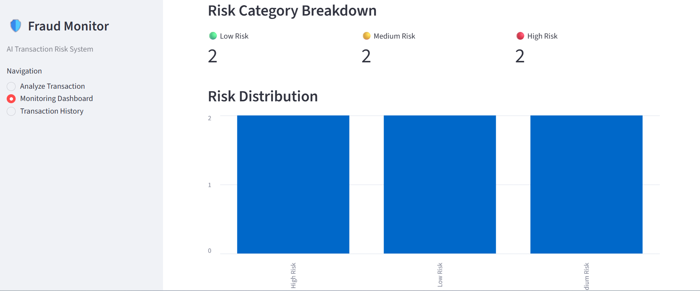
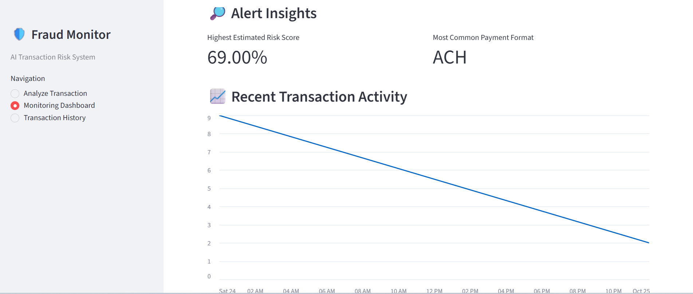
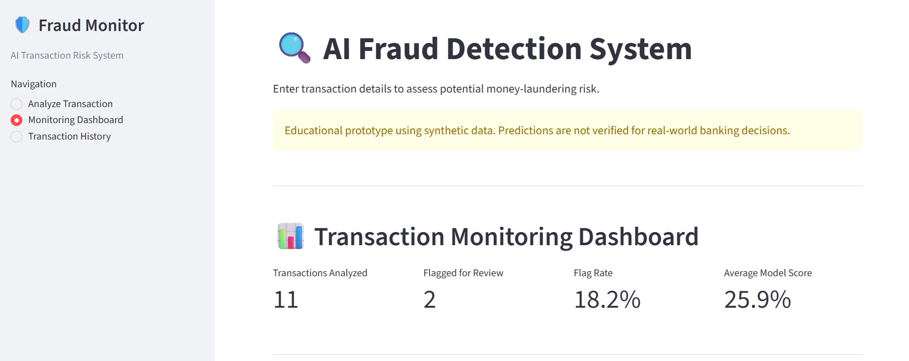
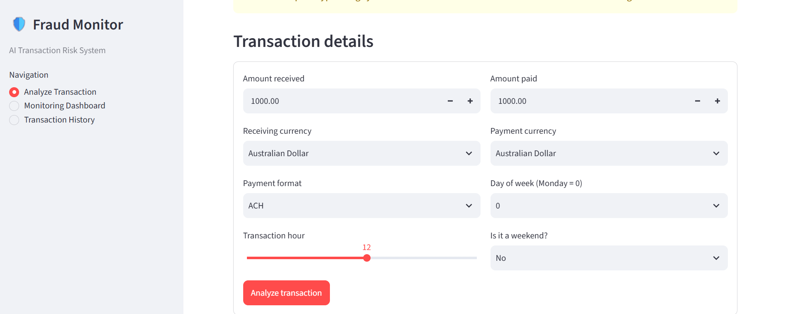
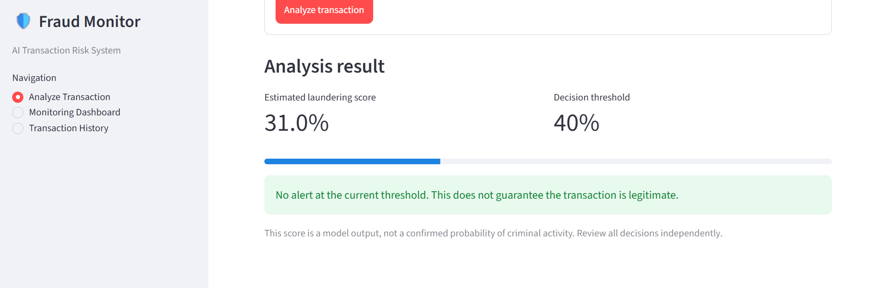
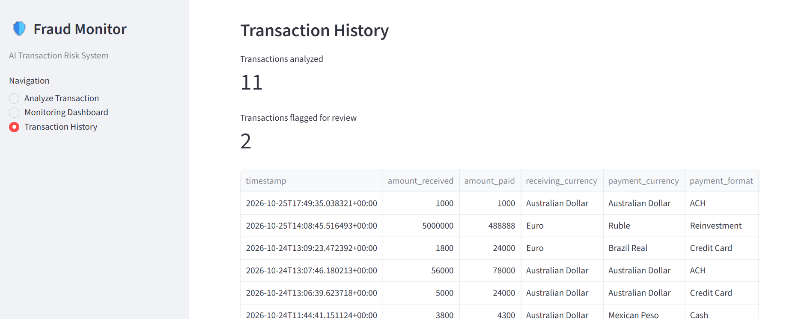
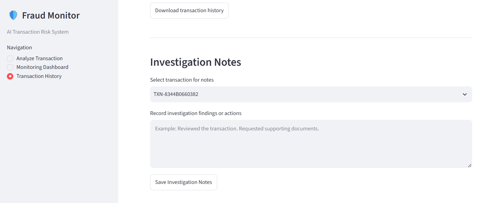

# AI-Powered Fraud Detection System

An interactive machine learning application for analyzing financial transactions, identifying potentially suspicious activity, and supporting fraud investigation workflows.

**Built with Python, Streamlit, pandas, machine learning, and Git.**

[Live Demo](https://kojo-pinto-fraud-detection.streamlit.app/) · [GitHub Repository](https://github.com/KOJOPINTO/AI_Fraud_Detection)

## Project Overview

Financial institutions process large volumes of transactions, making it challenging to identify suspicious activity efficiently. This project explores how machine learning can help flag potentially suspicious transactions and organize them for further review.

The application combines transaction analysis, risk scoring, monitoring, and investigation recordkeeping in an interactive dashboard.

This is an educational portfolio project using synthetic anti-money-laundering data. It is not a production fraud detection system.

## Key Features

- **Transaction Analysis:** Analyze transaction details and obtain a model-generated prediction and risk classification.
- **Monitoring Dashboard:** Review flagged transactions and explore monitoring metrics.
- **Transaction History:** Review previously analyzed transactions using persistent transaction IDs.
- **Investigation Workflow:** Record investigation statuses and notes for individual transactions.
- **Report Export:** Download transaction history and flagged transaction reports as CSV files.
- **Interactive Interface:** Explore transaction information through a Streamlit application.


## Application Screenshots

### Monitoring Dashboard




### Transaction Analysis



### Transaction History




## Technology Stack

| Technology | Purpose |
|---|---|
| Python | Application logic and data processing |
| pandas | Data manipulation and transaction history |
| Machine learning | Transaction classification and risk scoring |
| Streamlit | Interactive web application |
| Git and GitHub | Version control and project documentation |
| PostgreSQL | Persistent transaction storage and investigation records |
| psycopg | Python-to-PostgreSQL database connectivity |
| python-dotenv | Loading database configuration from environment variables |

## How It Works

1. A user enters transaction details.
2. The application processes the transaction using the configured prediction model.
3. The model returns a prediction and risk score.
4. The application displays the result and records the analysis.
5. Users review flagged transactions and record investigation findings.

## Project Structure

```text
## Project Structure

```text
AI_Fraud_Detection/
├── app.py
├── main.py
├── src/
│   ├── predict.py
│   ├── transaction_log.py
│   └── database.py
├── data/
├── models/
├── notebooks/
│   └── exploratory_analysis.ipynb
├── migrate_history.py
├── test_prediction.py
├── test_database.py
├── requirements.txt
├── .gitignore
└── README.md
```

The raw dataset and local transaction history are excluded from version control to avoid publishing large or potentially sensitive data files.

## Run Locally

### 1. Clone the repository

```bash
git clone https://github.com/KOJOPINTO/AI_Fraud_Detection.git
cd AI_Fraud_Detection
```

### 2. Create a virtual environment

```bash
python -m venv .venv
```

Activate it on Windows:

```powershell
.venv\Scripts\Activate.ps1
```

### 3. Install dependencies

```bash
pip install -r requirements.txt
```

### 4. Start the application

```bash
python -m streamlit run app.py
```

**Note:** Running the application from a fresh clone also requires the trained model artifact and any other runtime assets expected by the application. These must be made available through the project's documented setup process.

## PostgreSQL Database Setup

The application uses PostgreSQL to store transaction predictions and investigation records. Transaction history can be retrieved from the database, and investigation statuses and notes can be updated persistently.

### 1. Install PostgreSQL

Install PostgreSQL and create a database for the project.

Example database name:

```sql
CREATE DATABASE fraud_detection_db;
```

The application expects a `transactions` table with fields for transaction details, prediction results, risk classifications, and investigation records.

### 2. Configure environment variables

Create a `.env` file in the project root:

```env
DB_HOST=localhost
DB_PORT=5432
DB_NAME=fraud_detection_db
DB_USER=postgres
DB_PASSWORD=your_local_database_password
```

Replace the example password with your own local PostgreSQL password. Never commit `.env` or expose database credentials in source code.

### 3. Install database dependencies

```bash
pip install "psycopg[binary]" python-dotenv
```

### 4. Test the database connection

```bash
python -m src.database
```

### 5. Migrate existing transaction history

If you have an existing transaction-history CSV file and the required database table is already created, run:

```bash
python migrate_history.py
```

The migration script imports historical records into PostgreSQL. Existing transaction IDs are skipped to help avoid duplicate imports.

### 6. Run the application

```bash
python -m streamlit run app.py
```

### 7. Run the database test

```bash
python test_database.py
```

**Important:** The commands above assume PostgreSQL is installed, the database and table have been created, `.env` is configured, and the project's runtime assets are available. The raw dataset, local transaction history, and database credentials should remain excluded from version control.

## Model Evaluation and Limitations

Fraud detection is challenging because suspicious transactions are typically much less common than legitimate transactions.

A useful evaluation should consider precision, recall, false positives, and missed suspicious transactions rather than relying on accuracy alone.

The model's scores are experimental and should not be interpreted as calibrated real-world fraud probabilities. The application supports investigation decisions but does not establish that a transaction is fraudulent.

The project uses synthetic data and has not been validated for deployment in a real financial institution.

## Future Improvements

-## Future Improvements

- Expand automated tests and database error handling.
- Improve model evaluation and threshold selection.
- Strengthen secure configuration and deployment practices.
- Explore automated alerts and business workflow integrations.

## About the Developer

I am a data analytics graduate developing practical skills in Python, SQL, machine learning, data visualization, and AI automation.

This project demonstrates my approach to translating a data problem into an interactive application while continuing to develop my software engineering and analytical skills.

**Interested in data analytics, fraud analytics, and business process automation opportunities.**
